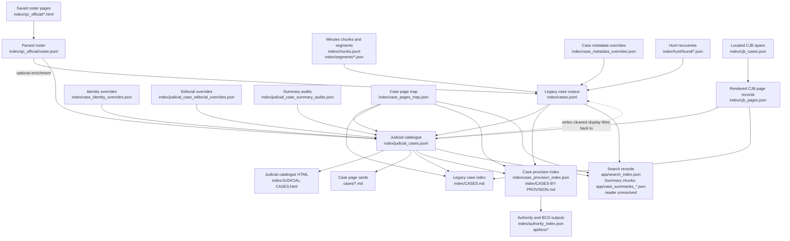

# Judicial-case data flow

This document defines the roles of the case-related files in `index/` and the
main path from source material to public and search records. It is a maintenance
guide, not a second case catalogue. The record schemas and controlled values
remain defined by the generating scripts and
[the judicial-case taxonomy](JUDICIAL-CASE-TAXONOMY.md).

## Flow at a glance

The roster and legacy case corpus answer different questions. The roster helps
track official judicial matters; the legacy corpus combines Minutes-derived
records with hunt recoveries and, when roster enrichment is run, roster stubs.
The catalogue joins those sources while preserving roster-only records and
approved minutes-supported additions. The taxonomy generator also syncs its
cleaned display titles back into the legacy corpus.

The routine Gradle site build consumes the checked-in case JSONL records; it
does not run `scripts/07_build_cases.py` or `scripts/12_case_taxonomy.py` to
refresh them. Roster enrichment and hunt merging are additional mutations of
`cases.jsonl`. This is a build-graph gap: upstream case-source changes are not
currently carried through to these records by `siteBuild`. Add the owning
generators and their prerequisites to Gradle before treating a site build as an
end-to-end case-data rebuild.

## Source and maintained inputs

| Artifact | Grain and authority | Producer or editor | Consumers and maintenance |
|---|---|---|---|
| `index/sjc_official/*.html` | Saved Historical Center SJC roster pages. Source snapshots for rebuilding the parsed roster. | Saved source material; parsed by `scripts/sjc_roster.py`. | Keep as reproducibility and provenance inputs. They are not case decision text. |
| `index/sjc_official/roster.jsonl` | One parsed official roster entry, including source identifiers and citation data. Coverage checklist, not the complete catalogue universe. | `scripts/sjc_roster.py` from the saved HTML. | Read by roster reconciliation and `scripts/12_case_taxonomy.py`; also included in the source registry. Regenerate from the snapshots. |
| `index/sjc_official/missing.jsonl` | Official roster entries not matched by the extraction workflow. | `scripts/09_reconcile_roster.py`. | Read by `scripts/10_hunt.py` for hunt/recovery; workflow state, not a public catalogue. |
| `cases/*.md` and Minutes sources | Case decision/status pages. The Minutes are authoritative for decision wording; repository pages are the readable case representation. | Case-page extraction and repair workflows; reviewed edits are preserved in these pages. | Used by case-page reconciliation, catalogue rendering, and the site. Never replace decision text with a synopsis. |
| `index/case_metadata_overrides.json` | Audited structured corrections or missed records for the extracted corpus. | Maintained corrections applied by `scripts/07_build_cases.py`. | Input to the extracted corpus build. Treat as maintained source data, not disposable generated output. |
| `index/case_identity_overrides.json` | Approved identity mappings and minutes-supported supplemental judicial dockets. | Maintained review decisions; applied by `scripts/12_case_taxonomy.py`. | Controls canonical identity, split/consolidated docket relationships, and approved additions to the catalogue. |
| `index/judicial_case_editorial_overrides.json` | Editorial fields that should be applied to catalogue records. | Maintained editorial decisions; applied by `scripts/12_case_taxonomy.py`. | Input to `judicial_cases.jsonl`; preserve as the durable editorial layer. |
| `index/judicial_case_summary_audits.json` | Summary audit results and their source/basis metadata. | `scripts/14_judicial_summary_audit.py`. | Read by `scripts/12_case_taxonomy.py` to expose audit status. Regenerable audit evidence; substantive rewrites belong in editorial overrides. |
| `index/case_pages_overrides.json` | Durable corrections to case-page discovery and docket-to-page mapping. | Maintained corrections consumed by `scripts/27_case_index_reconcile.py`. | Used to prevent reconciliation from restoring known-bad page targets. |
| `index/case_title_overrides.json` | Explicit title corrections for structured case pages. | Maintained corrections consumed by `scripts/26_case_pages_structured.py` and `scripts/47_refresh_existing_case_pages.py`. | Input to page metadata generation; retain corrections even when generated maps can be rebuilt. |

## Structured records and generated outputs

| Artifact | Grain and role | Producer | Consumers and maintenance |
|---|---|---|---|
| `index/cases.jsonl` | One legacy case-centric record per indexed case, with a normalized docket where available. The corpus can include Minutes-derived SJC/CJB cases, hunt recoveries, roster stubs, and numberless fallback records; records carry source provenance where available. | `scripts/07_build_cases.py` rolls up segments/chunks and applies `case_metadata_overrides.json`; `scripts/09_reconcile_roster.py --enrich` and `scripts/11_merge_hunt.py` can add/enrich records; `scripts/12_case_taxonomy.py` syncs cleaned display titles back into it. | Used by the taxonomy builder, case provision builder, search builder, source registry, and legacy case workflows. It is a generated record layer with multiple explicit mutators, not a strict minutes-only extract. |
| `index/judicial_cases.jsonl` | One catalogue record per unique canonical judicial docket after roster deduplication, approved supplements, companion-docket expansion, and editorial classification. Not every row must match an extracted row in `cases.jsonl`. | `scripts/12_case_taxonomy.py`. Inputs include the roster, extracted records, CJB/page data, identity rules, editorial overrides, and summary audits. | Used by the public judicial catalogue, case cards, search, authority/provision indexing, and case page metadata sync. Generated catalogue layer; its meaning and coverage are distinct from `cases.jsonl`. |
| `index/case_pages_map.json` | Mapping from normalized case identifiers to repository case pages and page metadata. | Written by `scripts/26_case_pages_structured.py`, `scripts/27_case_index_reconcile.py`, and `scripts/28_sjc_located_pages.py`. | Used by case indexes, search/linking, RPR generation, and provision indexing. Regenerable with durable corrections held separately in `case_pages_overrides.json`. |
| `index/cjb_cases.json` | Located CJB case spans and metadata used to slice early committee-era decisions from Minutes. | Maintained locator input; no in-repository producer was identified in this audit. | Read by `scripts/27_cjb_pages.py`; retain as source data for CJB case pages. |
| `index/cjb_pages.json` | Rendered page metadata for located CJB cases. | `scripts/27_cjb_pages.py` reads `cjb_cases.json`, slices the source Minutes, and writes these page records plus `cases/*.md`. | Read by the catalogue and case index builders. Generated output. |
| `index/case_provision_index.json` | Auditable case-to-constitutional-provision rows, including evidence sources. | `scripts/44_case_provision_index.py`. | Consumed by authority/provision catalogue and site builds. Regenerate from both structured case layers, case pages, and page mappings. |
| `index/JUDICIAL-CASES.html` | Rendered one-row-per-catalogue-case public view. | `scripts/13_judicial_taxonomy_index.py`; Gradle task `generateJudicialCatalogue`. | Site output generated from `judicial_cases.jsonl` and case pages. Do not hand-edit. |
| `index/CASES.md` and `index/CASES-BY-PROVISION.md` | Human-readable case and provision views. | `scripts/20_markdown_index.py` and `scripts/44_case_provision_index.py`, respectively. | Public/site views generated from case pages, maps, and structured records. Do not treat these views as the only source for metadata. |
| `app/search_index.json` | Search rows consumed by the web app. | `scripts/35_search_index.py`; Gradle task `rebuildSearchIndex`. | Runtime search data. Generated output. |
| `app/case_summaries_*.json` | Chunked case-summary payloads generated alongside search rows. | `scripts/35_search_index.py`; tracked as outputs of Gradle task `rebuildSearchIndex`. | `sw.js` precaches chunks 1 and 2. No code path that fetches or reads the chunks was found in this audit, so the runtime consumer is unresolved; verify before treating them as removable or required. |
| `index/authority_index.json`, `api/bco/*`, and related provision outputs | Downstream authority, BCO, and search representations that can include case-derived evidence. | Authority, provision, and BCO manifest generators in the Gradle graph. | Derived from the provision catalogue and case provision index. Regenerate through the Gradle build graph. |

## Auxiliary and audit artifacts

| Artifact | Current role | Finding |
|---|---|---|
| `index/case_citations.jsonl` | Precedent-edge export written by `scripts/07_build_cases.py`. | No semantic reader was found in the current repository audit. Broad Gradle `fileTree('index')` inputs may fingerprint it for task up-to-date checks, but that is not a data consumer. Treat it as a cleanup candidate pending confirmation of its intended use. |
| `index/case_identity_audit.json` and `index/case_identity_override_candidates.json` | Identity audit and proposed correction records. | No semantic reader was found in the current repository audit. Broad Gradle `fileTree('index')` inputs may fingerprint them for task up-to-date checks, but that is not a data consumer. Preserve as review evidence until their provenance and retention owner are decided. |
| `index/case_extraction_overrides.json` | Targeted extraction repair/review data. | Not an input to the routine `07_build_cases.py` rollup. It is referenced by the case extraction override validation/repair workflow, including tests. Keep while that workflow remains supported. |
| `index/case_provision_index.json`, `index/case_pages_map.json`, `index/cases.jsonl`, `index/judicial_cases.jsonl` | Generated files with case-related names. | Each has active downstream consumers; the `case_` prefix alone does not imply an obsolete or auxiliary file. |

## Maintenance rules

1. Keep source evidence, maintained overrides, generated records, and audit
   evidence distinguishable. A file's absence from the rendered site does not
   make it safe to remove if it is needed to reproduce or review a record.
2. Keep repository data and site builds on the Gradle build graph. The current
   graph does not refresh the case JSONL layers; wire their producers and
   prerequisites into Gradle before relying on `siteBuild` for an end-to-end
   case-data rebuild. Inspect every generated diff.
3. Before removing an artifact, confirm its producer, all code and build-graph
   consumers, deployment role, and retention purpose. If it is generated but
   has no consumer, remove or retire the producer and the artifact together.
4. Keep the scope distinction explicit: `cases.jsonl` is the legacy
   case-centric record layer; `judicial_cases.jsonl` is the canonical editorial
   catalogue. Neither file is a strict replacement for the other under the
   current data model.
