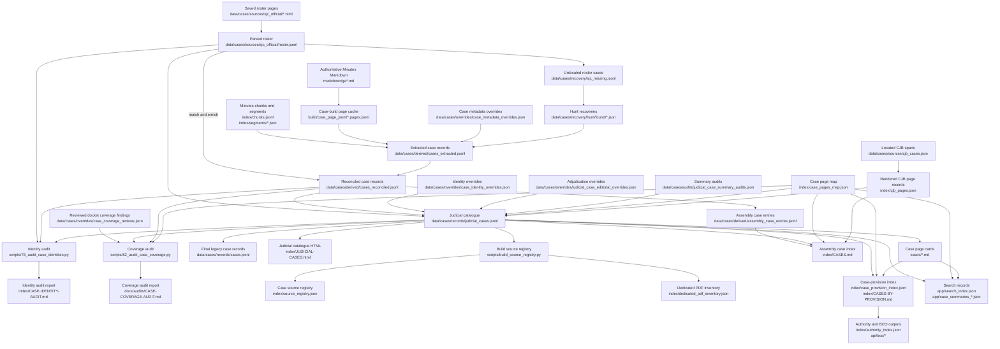

# Judicial-case data flow

This document defines the roles of the case-related source, review, record, and
output files and the main path from source material to public and search
records. It is a maintenance guide, not a second case catalogue. The record
schemas and controlled values remain defined by the generating scripts and
[the judicial-case taxonomy](JUDICIAL-CASE-TAXONOMY.md).

## Flow at a glance

The roster and legacy case corpus answer different questions. The roster helps
track official judicial matters; the legacy corpus combines Minutes-derived
records with hunt recoveries. Roster reconciliation enriches matching records
and records unmatched official cases in the recovery list. The catalogue joins
those sources while preserving roster-only records and approved
minutes-supported additions. The taxonomy generator also syncs its cleaned
display titles into the final legacy record file.

`judicial_cases.jsonl` is now the shared downstream source for canonical case
metadata. The public judicial catalogue, case-page metadata sync, search case
rows, case/provision index, and case entries in `source_registry.json` read it.
The canonical rows also carry source Assembly, PDF-page, and printed-folio
fields used for citation display and source links; downstream renderers and
the GA53 overture research join no longer fall back to `cases.jsonl` for those
values.
The roster contributes case PDF links during catalogue construction; downstream
registry generation reads those links from the canonical records rather than
re-reading the roster. `cases.jsonl` is still emitted as a compatibility copy
with canonical display titles, but the Gradle case pipeline and audits consume
the earlier extracted/reconciled layers directly. The identity audit compares
roster captions against `cases_reconciled.jsonl` and the canonical catalogue;
it does not use `cases.jsonl`, whose titles are synchronized from the canonical
catalogue. `index/CASES.md` reads source-located
observations from `assembly_case_entries.jsonl` to locate Assembly appearances
and uncatalogued reference rows. Where an entry matches a canonical docket and
its caption supports that identity, the canonical catalogue supplies the
docket, title, disposition, summary, and decision destination. Unmatched
entries remain source-derived reference evidence; they are not promoted to
case records. The coverage audit reads reconciled extraction records and the
canonical catalogue to find page-coverage gaps and compare extracted
dispositions. It no longer depends on the duplicate `cases.jsonl` output.
`judicial_cases.jsonl` records canonical cases, not every Assembly
appearance or citation, so those entry observations remain a distinct grain.

`index/pca_minutes.db` is the reusable derived index for page and section FTS,
canonical case lookup, structure, overtures, roster, and concordance data. It
is not an editorial source: maintained JSONL, JSON, Markdown, and roster files
remain the sources from which Gradle rebuilds the database.

Gradle task `buildMinutesDatabase` orchestrates `scripts/05_index.py`,
`scripts/08_index_cases.py`, and `scripts/19_export.py`. It rebuilds the page
layer from `build/case_page_jsonl/`, then refreshes the canonical case and
structure/catalogue layers. The hunt and minutes catalogue renderers read the
same database, avoiding a second page-search cache with overlapping content.

The OCR and page-review workflow keeps its curated page rows in
`build/page_jsonl/`. Case extraction and the SQLite database derive a separate
Markdown-only cache in `build/case_page_jsonl/`; this cache supplies page text
and volume anchors without replacing curated OCR/review rows. Gradle passes
this cache location to `scripts/05_index.py` and `scripts/11_merge_hunt.py`
through `PCA_CASE_PAGE_JSONL`; manual OCR/index workflows keep their default.

The Gradle graph includes `buildPageJsonl`, `buildSjcRoster`, `buildCaseCorpus`,
`reconcileCaseRoster`, `buildJudicialCaseRecords`, and `buildAssemblyCaseEntries`
before the dependent case views and indexes. `buildPageJsonl` derives the page text and anchors needed for
case extraction from tracked Markdown into the case-build cache. Corpus and
roster reconciliation use separate intermediate files, and the catalogue
builder writes the checked-in record layers. This keeps each Gradle stage's
inputs and outputs distinct.

The catalogue is reproducible from the roster, case records, identity rules,
page mappings, and maintained adjudication overrides. The overrides preserve
reviewed summaries, outcomes, dates, assembly values, and other decisions that
must not be inferred differently on a later build. Source and recovery files
provide provenance and evidence; the override layer records judgments made
from that evidence. The generated page map and provision index remain under
`index/` for now because their checked-in paths are used by several downstream
builders; moving them requires a separate producer/consumer update.

Coverage is reviewed separately from case classification. The coverage audit
compares final legacy case records, canonical docket records, and mapped case
pages. Reviewed exceptions are retained in
`case_coverage_reviews.json` and included in the generated audit report. A
numeric gap alone does not establish an assigned docket; only a source-attested
docket belongs in `judicial_cases.jsonl`.

## Source and maintained inputs

| Artifact | Grain and authority | Producer or editor | Consumers and maintenance |
|---|---|---|---|
| `build/page_jsonl/*.pages.jsonl` | Curated page-level OCR and review rows. | `scripts/01_extract.py` and the OCR/review tools, including reviewed and re-OCR text. | Used by OCR, review, and page indexing workflows. Treat these as maintained page data; the judicial-case Gradle build does not write here. |
| `data/cases/sources/sjc_official/*.html` | Saved Historical Center SJC roster pages. Source snapshots for rebuilding the parsed roster. | Saved source material; parsed by `scripts/sjc_roster.py`. | Keep as reproducibility and provenance inputs. They are not case decision text. |
| `data/cases/sources/sjc_official/roster.jsonl` | One parsed official roster entry, including source identifiers, citation data, and candidate PDF links. Coverage checklist, not the complete catalogue universe. | `scripts/sjc_roster.py` from the saved HTML. | Read by roster reconciliation and `scripts/12_case_taxonomy.py`; the catalogue build carries assigned case PDF links into `judicial_cases.jsonl`. The downstream source registry reads the canonical catalogue, not the roster. Regenerate from the snapshots. |
| `data/cases/recovery/sjc_missing.jsonl` | Official roster entries not matched by the extraction workflow. | `scripts/09_reconcile_roster.py`; Gradle task `reconcileCaseRoster`. | Read by `scripts/10_hunt.py` for hunt/recovery; workflow state, not a public catalogue. |
| `cases/*.md` and Minutes sources | Case decision/status pages. The Minutes are authoritative for decision wording; repository pages are the readable case representation. | Case-page extraction and repair workflows; reviewed edits are preserved in these pages. | Used by case-page reconciliation, catalogue rendering, and the site. Never replace decision text with a synopsis. |
| `data/cases/overrides/case_metadata_overrides.json` | Audited structured corrections or missed records for the extracted corpus. | Maintained corrections applied by `scripts/07_build_cases.py`. | Input to the extracted corpus build. Treat as maintained source data, not disposable generated output. |
| `data/cases/overrides/case_identity_overrides.json` | Approved identity mappings and minutes-supported supplemental judicial dockets. | Maintained review decisions; applied by `scripts/12_case_taxonomy.py`. | Controls canonical identity, split/consolidated docket relationships, and approved additions to the catalogue. |
| `data/cases/overrides/judicial_case_editorial_overrides.json` | Adjudicated catalogue values, including reviewed summaries, outcomes, disposition detail, assembly/year, titles, topics, and review fields. | Maintained decisions applied by `scripts/12_case_taxonomy.py`. | Authoritative override layer for values that cannot safely be inferred; required for repeatable `judicial_cases.jsonl` regeneration. |
| `data/cases/overrides/case_coverage_reviews.json` | Reviewed docket-number coverage findings, including explicitly reviewed not-found candidates and their search evidence. These findings are not case records. | Maintained review decisions. | Read by `scripts/82_audit_case_coverage.py` and rendered in the coverage audit. Add a candidate only after documenting the search and evidence; promote it to the canonical catalogue only if a source establishes that the docket was assigned. |
| `data/cases/audits/judicial_case_summary_audits.json` | Summary audit results and their source/basis metadata. | `scripts/14_judicial_summary_audit.py`. | Read by `scripts/12_case_taxonomy.py` to expose audit status. Regenerable audit evidence; substantive rewrites belong in editorial overrides. |
| `data/cases/overrides/case_pages_overrides.json` | Durable corrections to case-page discovery and docket-to-page mapping. | Maintained corrections consumed by `scripts/27_case_index_reconcile.py`. | Used to prevent reconciliation from restoring known-bad page targets. |
| `data/cases/overrides/case_title_overrides.json` | Explicit title corrections for structured case pages. | Maintained corrections consumed by `scripts/26_case_pages_structured.py` and `scripts/47_refresh_existing_case_pages.py`. | Input to page metadata generation; retain corrections even when generated maps can be rebuilt. |
| `data/cases/overrides/assembly_case_entry_reviews.json` | Reviewed include/exclude decisions for extracted Assembly case-entry observations, with reasons. | Maintained review decisions consumed by `scripts/83_build_assembly_case_entries.py`. | Prevents known false extractions from appearing as cases while retaining the source observation and its provenance in the generated entry file. |

## Structured records and generated outputs

| Artifact | Grain and role | Producer | Consumers and maintenance |
|---|---|---|---|
| `build/page_jsonl/*.pages.jsonl` | Curated page text, physical page locations, and OCR/review evidence for the Minutes corpus. | Maintained by the OCR/page-review workflow. | Remains separate from the Markdown-derived case-page cache; it is not overwritten by the case or database build. |
| `build/case_page_jsonl/*.pages.jsonl` | Markdown-derived full assembly pages used as a disposable input cache for case extraction and the page layer of the SQLite index. | Gradle task `buildPageJsonl` runs `scripts/00_build_page_jsonl.py --markdown-only` from tracked Minutes Markdown. | Read by Gradle task `buildCaseCorpus` and `buildMinutesDatabase`, and by `scripts/11_merge_hunt.py`. Separate from curated OCR/review rows in `build/page_jsonl/`. |
| `data/cases/derived/assembly_case_entries.jsonl` | Source-located Assembly case-listing observations with extracted docket/caption and page provenance; an entry is not itself a canonical case. | Gradle task `buildAssemblyCaseEntries` runs `scripts/83_build_assembly_case_entries.py` from reconciled extraction records and entry-review decisions. | Read by `scripts/20_markdown_index.py` for Assembly appearances and unresolved references. Matched identity and editorial metadata come from `judicial_cases.jsonl`. Generated open-format intermediate. |
| `index/pca_minutes.db` | Ignored, reusable derived SQLite index containing page/section FTS plus canonical case, structure, overture, roster, and concordance tables. | Gradle task `buildMinutesDatabase` orchestrates `scripts/05_index.py`, `scripts/08_index_cases.py`, and `scripts/19_export.py`. | Read by hunt recovery and the minutes catalogue renderer. Its source data remains in tracked Markdown, JSONL, JSON, and roster snapshots. |
| `data/cases/derived/cases_extracted.jsonl` | Extracted case-centric records before official-roster enrichment. | Gradle task `buildCaseCorpus` runs `scripts/07_build_cases.py` from page text, chunks, segments, recovery records, and metadata overrides. | Intermediate input to roster reconciliation. |
| `data/cases/derived/cases_reconciled.jsonl` | Minutes-derived records after roster matching and enrichment; titles remain independent from canonical display-title cleanup. | Gradle task `reconcileCaseRoster` runs `scripts/09_reconcile_roster.py --enrich`. | Input to canonical catalogue generation, Assembly-entry extraction, and both case identity and coverage audits. |
| `data/cases/records/cases.jsonl` | Final compatibility copy of the case-centric records, with normalized dockets and canonical display titles. | `scripts/12_case_taxonomy.py` writes it from reconciled extraction records and synchronizes canonical titles. | No current Gradle catalogue, site index, or audit reads it; older/manual workflows and compatibility checks may still use it. |
| `data/cases/records/judicial_cases.jsonl` | One catalogue record per unique canonical judicial docket after roster deduplication, approved supplements, companion-docket expansion, and editorial classification. Not every row must match an extracted row in `cases.jsonl`. | Gradle task `buildJudicialCaseRecords` runs `scripts/12_case_taxonomy.py`. Inputs include the roster, reconciled legacy records, CJB/page data, identity rules, adjudication overrides, and summary audits. | Canonical downstream case source for the public judicial catalogue, case-page extraction helpers, hunt/recovery matching, search case rows, case/provision indexing, source-registry case mappings, and GA53 case joins/audits. It preserves extracted `bco_cited_as` / `bco_cited_current` observations separately from editorial `bco_provisions`, and carries source volume/page and printed-folio provenance. |
| `index/case_pages_map.json` | Mapping from normalized case identifiers to repository case pages and page metadata. | Written by `scripts/26_case_pages_structured.py`, `scripts/27_case_index_reconcile.py`, and `scripts/28_sjc_located_pages.py`. | Used by case indexes, search/linking, RPR generation, and provision indexing. It remains a checked-in intermediate until its page producers are integrated into Gradle. |
| `data/cases/sources/cjb_cases.json` | Located CJB case spans and metadata used to slice early committee-era decisions from Minutes. | Maintained locator input; no in-repository producer was identified in this audit. | Read by `scripts/27_cjb_pages.py`; retain as source data for CJB case pages. |
| `index/cjb_pages.json` | Rendered page metadata for located CJB cases. | `scripts/27_cjb_pages.py` reads `cjb_cases.json`, slices the source Minutes, and writes these page records plus `cases/*.md`. | Read by the catalogue and case index builders. Generated output. |
| `index/case_provision_index.json` | Auditable case-to-constitutional-provision rows, including evidence sources. | `scripts/44_case_provision_index.py`. | Consumed by authority/provision catalogue and site builds. Regenerate from `judicial_cases.jsonl`, case pages, and page mappings. |
| `index/JUDICIAL-CASES.html` | Rendered one-row-per-catalogue-case public view. | `scripts/13_judicial_taxonomy_index.py`; Gradle task `generateJudicialCatalogue`. | Site output generated from `judicial_cases.jsonl` and case pages. Printed-page citations use source-page fields in the canonical records, with case-page source text as a fallback. Do not hand-edit. |
| `index/CASES.md` and `index/CASES-BY-PROVISION.md` | Human-readable case and provision views. | `scripts/20_markdown_index.py` via Gradle task `generateMinutesIndexes`, and `scripts/44_case_provision_index.py`, respectively. | `CASES.md` uses `assembly_case_entries.jsonl` to retain source-located Assembly entries; canonical case identity and editorial metadata come from `judicial_cases.jsonl`. The provision view is generated from the canonical catalogue, case pages, and page map. |
| `index/source_registry.json` | Registry of durable case and other source identities, including canonical docket-to-source mappings. | `scripts/build_source_registry.py`; Gradle task `buildSourceRegistry`. | Case entries and PDF links are generated from `judicial_cases.jsonl`; it is not independently sourced from `sjc_official/roster.jsonl`. |
| `index/dedicated_pdf_inventory.json` | Inventory of source PDFs assigned to canonical records. | `scripts/build_source_registry.py`; Gradle task `buildSourceRegistry`. | Generated alongside the source registry from canonical source assignments. |
| `app/search_index.json` | Search rows consumed by the web app. | `scripts/35_search_index.py`; Gradle task `rebuildSearchIndex`. | Runtime search data. Case metadata is read from `judicial_cases.jsonl`; case text and uncatalogued mapped pages remain available through case pages and the page map. Generated output. |
| `app/case_summaries_*.json` | Chunked case-summary payloads generated alongside search rows. | `scripts/35_search_index.py`; tracked as outputs of Gradle task `rebuildSearchIndex`. | `sw.js` precaches chunks 1 and 2. No code path that fetches or reads the chunks was found in this audit, so the runtime consumer is unresolved; verify before treating them as removable or required. |
| `index/authority_index.json`, `api/bco/*`, and related provision outputs | Downstream authority, BCO, and search representations that can include case-derived evidence. | Authority, provision, and BCO manifest generators in the Gradle graph. | Derived from the provision catalogue and case provision index. Regenerate through the Gradle build graph. |

## Coverage review

| Artifact | Role | Producer or editor | Use |
|---|---|---|---|
| `scripts/78_audit_case_identities.py` | Repeatable comparison of the official roster, reconciled Minutes-derived records, and the canonical catalogue, with case-page and citation evidence. | Maintained audit script. | Run with `python scripts/78_audit_case_identities.py` to refresh its JSON and Markdown reports. It proposes review candidates but never changes case identities unless explicitly asked to promote approved candidates. |
| `scripts/82_audit_case_coverage.py` | Repeatable comparison of reconciled Minutes-derived case records, canonical records, and mapped case pages, with reviewed findings from the coverage-review input. | Maintained audit script. | Run with `python scripts/82_audit_case_coverage.py` to refresh the report. It reports pages lacking canonical docket coverage and includes retained findings; it does not modify case records. |
| `index/CASE-IDENTITY-AUDIT.md` and `data/cases/review/case_identity_audit.json` | Generated identity-audit findings and candidate mismatches. | `scripts/78_audit_case_identities.py`. | Review source evidence before changing identity rules; the report itself does not adjudicate the roster or catalogue. |
| `docs/audits/CASE-COVERAGE-AUDIT.md` | Generated view of current page coverage and reviewed docket-number findings. | `scripts/82_audit_case_coverage.py`. | Review after refreshing the audit. Durable adjudications belong in `case_coverage_reviews.json`, not only in this generated report. |
| `scripts/ga53_join.py` and `scripts/ga53_audit.py` | GA53 overture research helpers: join historical case citations to provisions and check docket references in the research findings. They do not catalogue cases from a 53rd Assembly. | Maintained GA53 workflow scripts. | Read canonical identities, metadata, and citation observations from `judicial_cases.jsonl`; use the page map and rendered `CASES.md` for links and structural cross-checks. |

## Auxiliary and audit artifacts

| Artifact | Current role | Finding |
|---|---|---|
| `data/cases/derived/case_citations.jsonl` | Precedent-edge export written by `scripts/07_build_cases.py`. | No semantic reader was found in the current repository audit. Gradle's `fileTree('data/cases')` inputs may fingerprint it for task up-to-date checks, but that is not a data consumer. Treat it as a cleanup candidate pending confirmation of its intended use. |
| `data/cases/review/case_identity_audit.json` and `data/cases/review/case_identity_override_candidates.json` | Identity audit and proposed correction records. | No semantic reader was found in the current repository audit. Gradle's `fileTree('data/cases')` inputs may fingerprint them for task up-to-date checks, but that is not a data consumer. Preserve as review evidence until their provenance and retention owner are decided. |
| `data/cases/overrides/case_extraction_overrides.json` | Targeted extraction repair/review data. | Not an input to the routine `07_build_cases.py` rollup. It is referenced by the case extraction override validation/repair workflow, including tests. Keep while that workflow remains supported. |
| `index/case_provision_index.json`, `index/case_pages_map.json`, `data/cases/records/cases.jsonl`, `data/cases/records/judicial_cases.jsonl` | Generated files with case-related names. | Each has active downstream consumers; the `case_` prefix alone does not imply an obsolete or auxiliary file. |

## Maintenance rules

1. Keep source evidence, maintained overrides, generated records, and audit
   evidence distinguishable. A file's absence from the rendered site does not
   make it safe to remove if it is needed to reproduce or review a record.
2. Keep repository data and site builds on the Gradle build graph. The case
   roster and record producers are wired into it; inspect every generated diff
   after a build, especially where a task updates a checked-in data record.
3. Before removing an artifact, confirm its producer, all code and build-graph
   consumers, deployment role, and retention purpose. If it is generated but
   has no consumer, remove or retire the producer and the artifact together.
4. Source shared case metadata from `judicial_cases.jsonl`. Keep
   `cases.jsonl` only as a compatibility output while remaining manual
   consumers are reviewed; use `assembly_case_entries.jsonl` for Assembly appearances
   and reference rows. Do not use the legacy case file as a competing source
   for canonical case identity or editorial fields.
