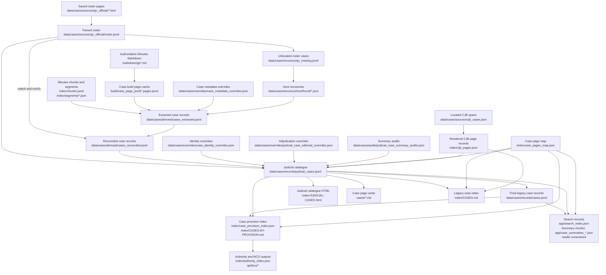

# Judicial-case data flow

This document defines the roles of the case-related source, review, record, and
output files and the main path from source material to public and search
records. It is a maintenance guide, not a second case catalogue. The record
schemas and controlled values remain defined by the generating scripts and
[the judicial-case taxonomy](JUDICIAL-CASE-TAXONOMY.md).

## Flow at a glance

The roster and legacy case corpus answer different questions. The roster helps
track official judicial matters; the legacy corpus combines Minutes-derived
records with hunt recoveries. Roster reconciliation enriches matching records
and records unmatched official cases in the recovery list. The catalogue joins
those sources while preserving roster-only records and approved
minutes-supported additions. The taxonomy generator also syncs its cleaned
display titles into the final legacy record file.

The OCR and page-review workflow keeps its curated page rows in
`build/page_jsonl/`. The judicial-case build derives a separate Markdown-only
page cache in `build/case_page_jsonl/`; this cache supplies page text and volume
anchors to case-description extraction and hunt-recovery matching, and never
replaces curated OCR/review rows. Gradle passes the cache location to both
`scripts/05_index.py` and `scripts/11_merge_hunt.py` through
`PCA_CASE_PAGE_JSONL`; manual OCR/index workflows keep their existing default.

The Gradle graph includes `buildPageJsonl`, `buildSjcRoster`, `buildCaseCorpus`,
`reconcileCaseRoster`, and `buildJudicialCaseRecords` before the dependent case
views and indexes. `buildPageJsonl` derives the page text and anchors needed for
case extraction from tracked Markdown into the case-build cache. Corpus and
roster reconciliation use separate intermediate files, and the catalogue
builder writes the checked-in record layers. This keeps each Gradle stage's
inputs and outputs distinct.

The catalogue is reproducible from the roster, case records, identity rules,
page mappings, and maintained adjudication overrides. The overrides preserve
reviewed summaries, outcomes, dates, assembly values, and other decisions that
must not be inferred differently on a later build. Source and recovery files
provide provenance and evidence; the override layer records judgments made
from that evidence. The generated page map and provision index remain under
`index/` for now because their checked-in paths are used by several downstream
builders; moving them requires a separate producer/consumer update.

## Source and maintained inputs

| Artifact | Grain and authority | Producer or editor | Consumers and maintenance |
|---|---|---|---|
| `build/page_jsonl/*.pages.jsonl` | Curated page-level OCR and review rows. | `scripts/01_extract.py` and the OCR/review tools, including reviewed and re-OCR text. | Used by OCR, review, and page indexing workflows. Treat these as maintained page data; the judicial-case Gradle build does not write here. |
| `data/cases/sources/sjc_official/*.html` | Saved Historical Center SJC roster pages. Source snapshots for rebuilding the parsed roster. | Saved source material; parsed by `scripts/sjc_roster.py`. | Keep as reproducibility and provenance inputs. They are not case decision text. |
| `data/cases/sources/sjc_official/roster.jsonl` | One parsed official roster entry, including source identifiers, citation data, and candidate PDF links. Coverage checklist, not the complete catalogue universe. | `scripts/sjc_roster.py` from the saved HTML. | Read by roster reconciliation and `scripts/12_case_taxonomy.py`; the catalogue build carries assigned case PDF links into `judicial_cases.jsonl`. The downstream source registry reads the canonical catalogue, not the roster. Regenerate from the snapshots. |
| `data/cases/recovery/sjc_missing.jsonl` | Official roster entries not matched by the extraction workflow. | `scripts/09_reconcile_roster.py`; Gradle task `reconcileCaseRoster`. | Read by `scripts/10_hunt.py` for hunt/recovery; workflow state, not a public catalogue. |
| `cases/*.md` and Minutes sources | Case decision/status pages. The Minutes are authoritative for decision wording; repository pages are the readable case representation. | Case-page extraction and repair workflows; reviewed edits are preserved in these pages. | Used by case-page reconciliation, catalogue rendering, and the site. Never replace decision text with a synopsis. |
| `data/cases/overrides/case_metadata_overrides.json` | Audited structured corrections or missed records for the extracted corpus. | Maintained corrections applied by `scripts/07_build_cases.py`. | Input to the extracted corpus build. Treat as maintained source data, not disposable generated output. |
| `data/cases/overrides/case_identity_overrides.json` | Approved identity mappings and minutes-supported supplemental judicial dockets. | Maintained review decisions; applied by `scripts/12_case_taxonomy.py`. | Controls canonical identity, split/consolidated docket relationships, and approved additions to the catalogue. |
| `data/cases/overrides/judicial_case_editorial_overrides.json` | Adjudicated catalogue values, including reviewed summaries, outcomes, disposition detail, assembly/year, titles, topics, and review fields. | Maintained decisions applied by `scripts/12_case_taxonomy.py`. | Authoritative override layer for values that cannot safely be inferred; required for repeatable `judicial_cases.jsonl` regeneration. |
| `data/cases/audits/judicial_case_summary_audits.json` | Summary audit results and their source/basis metadata. | `scripts/14_judicial_summary_audit.py`. | Read by `scripts/12_case_taxonomy.py` to expose audit status. Regenerable audit evidence; substantive rewrites belong in editorial overrides. |
| `data/cases/overrides/case_pages_overrides.json` | Durable corrections to case-page discovery and docket-to-page mapping. | Maintained corrections consumed by `scripts/27_case_index_reconcile.py`. | Used to prevent reconciliation from restoring known-bad page targets. |
| `data/cases/overrides/case_title_overrides.json` | Explicit title corrections for structured case pages. | Maintained corrections consumed by `scripts/26_case_pages_structured.py` and `scripts/47_refresh_existing_case_pages.py`. | Input to page metadata generation; retain corrections even when generated maps can be rebuilt. |

## Structured records and generated outputs

| Artifact | Grain and role | Producer | Consumers and maintenance |
|---|---|---|---|
| `build/case_page_jsonl/*.pages.jsonl` | Markdown-derived full assembly pages used as a disposable input cache for the judicial-case build. | Gradle task `buildPageJsonl` runs `scripts/00_build_page_jsonl.py --markdown-only` from tracked Minutes Markdown. | Read by Gradle task `buildCaseCorpus` through `scripts/05_index.py` for case-description text and `scripts/11_merge_hunt.py` for Minutes captions and volume mapping. Separate from curated OCR/review rows in `build/page_jsonl/`. |
| `data/cases/derived/cases_extracted.jsonl` | Extracted case-centric records before official-roster enrichment. | Gradle task `buildCaseCorpus` runs `scripts/07_build_cases.py` from page text, chunks, segments, recovery records, and metadata overrides. | Intermediate input to roster reconciliation. |
| `data/cases/derived/cases_reconciled.jsonl` | Extracted records enriched from the official roster. | Gradle task `reconcileCaseRoster` runs `scripts/09_reconcile_roster.py --enrich`. | Intermediate input to catalogue generation. |
| `data/cases/records/cases.jsonl` | Final legacy case-centric records with a normalized docket where available. It combines Minutes-derived SJC/CJB cases, hunt recoveries, roster enrichment, and cleaned catalogue titles; source provenance is retained where available. | Gradle task `buildJudicialCaseRecords` writes it from the reconciled intermediate alongside `judicial_cases.jsonl`. | Still used by the case provision builder, catalogue citation-page fallback, and legacy workflows. The search builder no longer reads it. It is a generated record layer, not the editorial authority for catalogue adjudications. |
| `data/cases/records/judicial_cases.jsonl` | One catalogue record per unique canonical judicial docket after roster deduplication, approved supplements, companion-docket expansion, and editorial classification. Not every row must match an extracted row in `cases.jsonl`. | Gradle task `buildJudicialCaseRecords` runs `scripts/12_case_taxonomy.py`. Inputs include the roster, reconciled legacy records, CJB/page data, identity rules, adjudication overrides, and summary audits. | Used by the public judicial catalogue, case cards, search, source registry case mappings, authority/provision indexing, and case page metadata sync. Search uses this for case metadata and keeps uncatalogued mapped pages searchable from the page map and page text. Generated canonical catalogue; its coverage is distinct from `cases.jsonl`, and adjudications are preserved through the override layer. |
| `index/case_pages_map.json` | Mapping from normalized case identifiers to repository case pages and page metadata. | Written by `scripts/26_case_pages_structured.py`, `scripts/27_case_index_reconcile.py`, and `scripts/28_sjc_located_pages.py`. | Used by case indexes, search/linking, RPR generation, and provision indexing. It remains a checked-in intermediate until its page producers are integrated into Gradle. |
| `data/cases/sources/cjb_cases.json` | Located CJB case spans and metadata used to slice early committee-era decisions from Minutes. | Maintained locator input; no in-repository producer was identified in this audit. | Read by `scripts/27_cjb_pages.py`; retain as source data for CJB case pages. |
| `index/cjb_pages.json` | Rendered page metadata for located CJB cases. | `scripts/27_cjb_pages.py` reads `cjb_cases.json`, slices the source Minutes, and writes these page records plus `cases/*.md`. | Read by the catalogue and case index builders. Generated output. |
| `index/case_provision_index.json` | Auditable case-to-constitutional-provision rows, including evidence sources. | `scripts/44_case_provision_index.py`. | Consumed by authority/provision catalogue and site builds. Regenerate from both structured case layers, case pages, and page mappings. |
| `index/JUDICIAL-CASES.html` | Rendered one-row-per-catalogue-case public view. | `scripts/13_judicial_taxonomy_index.py`; Gradle task `generateJudicialCatalogue`. | Site output generated from `judicial_cases.jsonl` and case pages. Do not hand-edit. |
| `index/CASES.md` and `index/CASES-BY-PROVISION.md` | Human-readable case and provision views. | `scripts/20_markdown_index.py` and `scripts/44_case_provision_index.py`, respectively. | Public/site views generated from case pages, maps, and structured records. Do not treat these views as the only source for metadata. |
| `app/search_index.json` | Search rows consumed by the web app. | `scripts/35_search_index.py`; Gradle task `rebuildSearchIndex`. | Runtime search data. Generated output. |
| `app/case_summaries_*.json` | Chunked case-summary payloads generated alongside search rows. | `scripts/35_search_index.py`; tracked as outputs of Gradle task `rebuildSearchIndex`. | `sw.js` precaches chunks 1 and 2. No code path that fetches or reads the chunks was found in this audit, so the runtime consumer is unresolved; verify before treating them as removable or required. |
| `index/authority_index.json`, `api/bco/*`, and related provision outputs | Downstream authority, BCO, and search representations that can include case-derived evidence. | Authority, provision, and BCO manifest generators in the Gradle graph. | Derived from the provision catalogue and case provision index. Regenerate through the Gradle build graph. |

## Auxiliary and audit artifacts

| Artifact | Current role | Finding |
|---|---|---|
| `data/cases/derived/case_citations.jsonl` | Precedent-edge export written by `scripts/07_build_cases.py`. | No semantic reader was found in the current repository audit. Gradle's `fileTree('data/cases')` inputs may fingerprint it for task up-to-date checks, but that is not a data consumer. Treat it as a cleanup candidate pending confirmation of its intended use. |
| `data/cases/review/case_identity_audit.json` and `data/cases/review/case_identity_override_candidates.json` | Identity audit and proposed correction records. | No semantic reader was found in the current repository audit. Gradle's `fileTree('data/cases')` inputs may fingerprint them for task up-to-date checks, but that is not a data consumer. Preserve as review evidence until their provenance and retention owner are decided. |
| `data/cases/overrides/case_extraction_overrides.json` | Targeted extraction repair/review data. | Not an input to the routine `07_build_cases.py` rollup. It is referenced by the case extraction override validation/repair workflow, including tests. Keep while that workflow remains supported. |
| `index/case_provision_index.json`, `index/case_pages_map.json`, `data/cases/records/cases.jsonl`, `data/cases/records/judicial_cases.jsonl` | Generated files with case-related names. | Each has active downstream consumers; the `case_` prefix alone does not imply an obsolete or auxiliary file. |

## Maintenance rules

1. Keep source evidence, maintained overrides, generated records, and audit
   evidence distinguishable. A file's absence from the rendered site does not
   make it safe to remove if it is needed to reproduce or review a record.
2. Keep repository data and site builds on the Gradle build graph. The case
   roster and record producers are wired into it; inspect every generated diff
   after a build, especially where a task updates a checked-in data record.
3. Before removing an artifact, confirm its producer, all code and build-graph
   consumers, deployment role, and retention purpose. If it is generated but
   has no consumer, remove or retire the producer and the artifact together.
4. Keep the scope distinction explicit: `cases.jsonl` is the legacy
   case-centric record layer; `judicial_cases.jsonl` is the canonical editorial
   catalogue. Neither file is a strict replacement for the other under the
   current data model.
